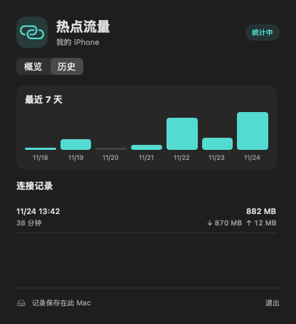

# 热点流量 · HotspotMeter

在 Mac 菜单栏查看 iPhone 个人热点的实时网速和累计用量。选定热点后，连接时自动开始统计，切换到其他 Wi‑Fi 时自动停止。

**适用设备**　搭载 Apple 芯片的 Mac，macOS 14 或更高版本。支持 Mac 通过 Wi‑Fi 连接 iPhone 个人热点。

**[下载 macOS DMG](https://github.com/Ba3ry/MAC-Hotspotmeter/releases/download/v1.2/HotspotMeter-1.2-arm64.dmg)** · [所有版本](https://github.com/Ba3ry/MAC-Hotspotmeter/releases)

## 功能

- 状态栏可分别显示图标、实时上传和下载速度、今日累计用量。显示选项自动保存。
- 原生菜单可查看本次连接的时长和用量，以及今日、本月累计。
- 历史窗口提供最近 7 天的流量趋势和连接记录。



*截图中的用量为示例数据。*

## 安装与使用

1. 点上方「下载 macOS DMG」，或在仓库的 **Releases → v1.2 → Assets** 下载 `HotspotMeter-1.2-arm64.dmg`。
2. 双击 DMG，在打开的磁盘映像窗口里把 `HotspotMeter.app` 拖到「应用程序」。从「应用程序」打开后，在「识别 iPhone 热点」窗口点「请求授权」，并在 macOS 弹窗里允许访问。
3. 让 Mac 连上 iPhone 个人热点。点菜单栏里的热点流量入口，打开「热点设置…」，确认 Wi‑Fi 名称后点「将此 Wi-Fi 设为热点」。
4. 从 **状态栏显示** 勾选要常驻的项目。至少保留一项，方便随时打开菜单。通过「查看历史记录…」打开历史窗口。

请在需要统计时保持应用运行。重新登录 Mac 后，从「应用程序」打开它即可继续。

**定位授权**　macOS 将当前 Wi‑Fi 名称的读取纳入定位权限。应用用网络名称识别热点。若没有看到授权弹窗，可在应用内点「打开定位服务设置」，检查「系统设置 → 隐私与安全性 → 定位服务」。[Apple 开发者说明](https://developer.apple.com/forums/thread/732431)

**发布包签名**　此构建采用临时签名（ad-hoc），Apple 公证状态为未公证。若 macOS 拦截从 GitHub 下载的应用，可以在本机从源码构建。[Apple 的应用安全说明](https://support.apple.com/zh-cn/102445)

## 统计口径与隐私

统计值来自这台 Mac 的 Wi‑Fi 网卡计数，覆盖应用运行期间、设备连接到已选热点时的收发流量。计费以运营商账单为准。为方便识别，建议给 iPhone 热点使用独特的名称。

应用仅在本机保存设置和用量。历史记录位于 `~/Library/Application Support/HotspotMeter/history.json`。定位授权用于读取 Wi‑Fi 名称，应用无坐标采集和遥测。

## 从源码构建

需要 Apple 芯片 Mac，以及 Xcode 或 Xcode Command Line Tools。项目使用 Swift、AppKit 和 SwiftUI，以及系统提供的 CoreWLAN 和 Core Location。

在仓库根目录运行：

```bash
bash scripts/test.sh
bash scripts/build.sh
bash scripts/make-dmg.sh
```

构建生成 `dist/HotspotMeter.app` 和 ZIP。打包命令生成 `dist/HotspotMeter-1.2-arm64.dmg`，可作为 GitHub Release 附件上传。测试覆盖计数器差值、跨日和跨月汇总、断线重连、采样中断与历史保存。

## 项目结构

| 路径 | 内容 |
| --- | --- |
| `Sources/` | 状态栏、历史面板、热点识别与流量采集 |
| `Resources/` | 应用配置和图标 |
| `Tests/` | 流量统计测试 |
| `scripts/` | 构建、打包和测试命令 |
| `docs/` | 界面截图 |
